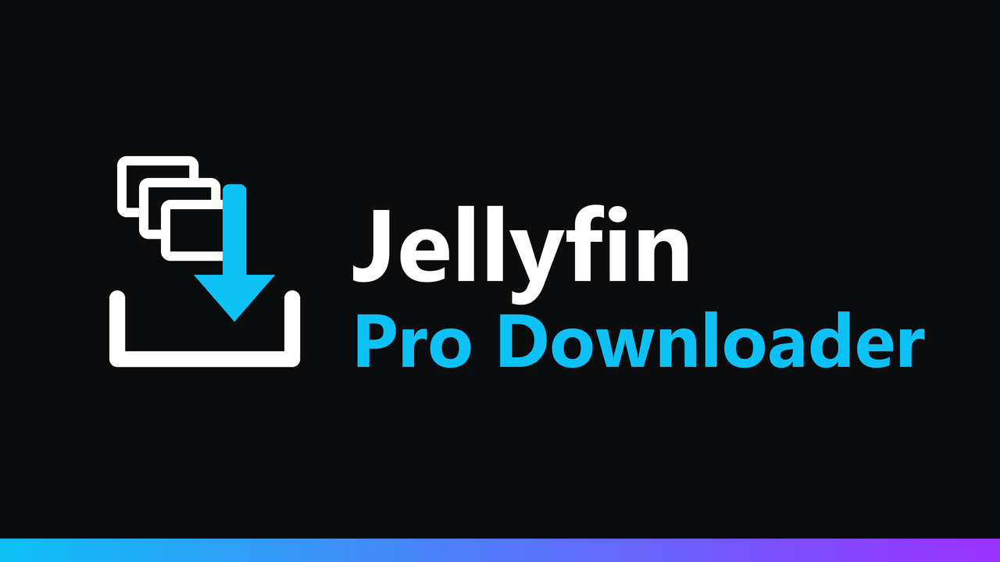

<p align="center">
  
</p>

<p align="center">
  <a href="https://github.com/k1k4k/jellyfin-pro-downloader/releases/latest"></a>
  
  <a href="https://github.com/k1k4k/jellyfin-pro-downloader/releases"></a>
  <a href="LICENSE"></a>
</p>

<p align="center">
  <b>Télécharger une série entière sans lancer 200 téléchargements d'un coup.</b><br>
  On choisit quoi, on choisit comment, et un gestionnaire de téléchargements suit le tout.
</p>

<p align="center">
  <a href="#installation">Installation</a> ·
  <a href="#fonctionnalités">Fonctionnalités</a> ·
  <a href="#dépannage">Dépannage</a> ·
  <a href="README.md">English version</a>
</p>

De base, « Tout télécharger » sur une série lance un téléchargement navigateur par épisode, tous en même temps : les 204 épisodes d'une longue série, ce sont 204 téléchargements simultanés, en vrac dans le dossier Téléchargements, sans savoir lesquels ont échoué.

## Fonctionnalités

### Choisir quoi télécharger

- **« Télécharger… »** dans le menu ⋮ d'une série, d'une saison, d'un album, d'un artiste, d'une collection, d'une playlist ou d'un dossier ouvre une fenêtre au lieu de tout lancer.
- Saisons, épisodes, albums et morceaux à cocher ou décocher, avec leur taille et le total.
- Les **fichiers annexes** à côté des médias sont inclus quand ils existent : sous-titres externes, `.nfo`, images, paroles (`.lrc`). Une case pour s'en passer.
- Un **film ou un épisode seul** se télécharge directement, sans fenêtre.

### Choisir comment

| Mode | Navigateurs | Résultat |
|---|---|---|
| **Dans un dossier** | Chrome, Edge, Opera sur ordinateur, en HTTPS (ou localhost) | Fichiers rangés dans un dossier de votre choix : `Série (2001)/Season 01/…`, `Artiste/Album/…`. Les fichiers déjà présents sont ignorés : un gros téléchargement peut se terminer un autre jour. |
| **File d'attente** | tous | Le navigateur télécharge les fichiers l'un après l'autre dans le dossier Téléchargements. Le serveur prévient la page quand un fichier est terminé pour lancer le suivant. |
| **ZIP** | tous | Une archive par saison / album, ou une seule, avec les dossiers déjà rangés. Générée à la volée (sans compression ni fichier temporaire, presque sans CPU), sa taille exacte est connue d'avance et un téléchargement interrompu peut reprendre. |

La fenêtre propose le meilleur mode disponible dans votre navigateur et retient votre choix.

### Suivre

- Un **gestionnaire de téléchargements** (icône de téléchargement en haut à droite) affiche chaque téléchargement avec sa progression et sa vitesse : pause, reprise, nouvel essai, annulation, et l'historique de ceux terminés (gardé dans votre navigateur seulement).
- **Les téléchargements non terminés sont proposés à nouveau** à chaque ouverture de Jellyfin, après confirmation.

### Limites côté serveur

Réglées dans **Tableau de bord → Extensions → Jellyfin Pro Downloader**, appliquées par le serveur quel que soit le client :

- téléchargements simultanés par utilisateur (2 par défaut) et au total ;
- débit maximum par utilisateur (illimité par défaut), utile avec une connexion montante modeste pour que les autres puissent continuer à regarder ;
- modes proposés ;
- expiration des liens.

Le droit **« Autoriser le téléchargement »** de chaque utilisateur (Tableau de bord → Utilisateurs) est respecté, et revérifié à chaque fichier.

## Installation

### Plugin (recommandé)

1. **Tableau de bord → Extensions → Gérer les dépôts → `+`**, puis l'adresse du dépôt de plugins k1k4k qui correspond à votre Jellyfin :

   | Jellyfin | Adresse du dépôt |
   |---|---|
   | 12.x | `https://k1k4k.github.io/jellyfin-plugins/manifest.json` |
   | 10.11.x | `https://k1k4k.github.io/jellyfin-plugins/manifest-10.11.json` |

   Ce dépôt liste tous les plugins k1k4k (Background Play, Player Queue, True Music Library…). Si vous l'avez déjà ajouté, ou celui de Player Queue, rien à faire.

2. **Extensions → Disponible → Jellyfin Pro Downloader → Installer**, puis redémarrez Jellyfin.
3. Rechargez la page web (`Ctrl+F5`).

Les nouvelles versions apparaissent dans le tableau de bord.

<details>
<summary><b>Autres méthodes (sans le dépôt)</b></summary>

#### Plugin, à la main

Téléchargez le zip de la [dernière release](https://github.com/k1k4k/jellyfin-pro-downloader/releases/latest) (`_jf12` pour Jellyfin 12, `_jf10` pour 10.11), décompressez-le dans `<config>/plugins/Jellyfin Pro Downloader/` et redémarrez Jellyfin.

#### Script d'installation

Copie le plugin dans le dossier `plugins` de Jellyfin (dernière release, zip d'une release, ou compilé depuis ces sources) en choisissant la variante qui correspond à la version du serveur.

```powershell
# Windows
.\install.ps1                                                                      # Jellyfin local
.\install.ps1 -PluginsDir "\\SERVEUR\plugins" -ServerUrl "http://SERVEUR:8096"     # partage réseau
.\install.ps1 -Build                                                               # depuis les sources (SDK .NET 10, ou 9 pour 10.11)
.\install.ps1 -Uninstall
```

```bash
# Linux (plugins dans /var/lib/jellyfin/plugins)
sudo ./install.sh --restart
sudo ./install.sh --uninstall
```

Puis redémarrez Jellyfin.

</details>

## Compatibilité

| | |
|---|---|
| **Jellyfin 12.x** | testé (12.1.0) |
| **Jellyfin 10.11** | serveur testé (10.11.11) ; le code du client web sur lequel le plugin s'appuie est le même qu'en 12.x |
| **Interface web** (mise en page classique et nouvelle) | oui |
| **Applis qui affichent l'interface web** (Jellyfin Media Player, appli Android) | devrait fonctionner, non testé ; les applis qui ont leur propre téléchargement le gardent |
| **Applis natives** (Swiftfin, Findroid…) | non concernées |
| **Derrière un reverse proxy, sur un NAS, en Docker** | oui ; voir la note nginx plus bas |

## Dépannage

- **Rien ne change dans le menu ⋮** : rechargez la page web avec `Ctrl+F5`, puis regardez la console du navigateur (F12) : `[ProDownloader] v… – ready`.
- **File d'attente : seul le premier fichier se télécharge** (Chrome, Edge) : le navigateur demande une fois si le site peut télécharger plusieurs fichiers. Autorisez-le (icône à droite de la barre d'adresse), puis **Réessayer** dans le gestionnaire.
- **Firefox demande où enregistrer chaque fichier** : Paramètres de Firefox → Général → Fichiers et applications → décochez « Toujours demander où enregistrer les fichiers ». Ou utilisez le mode ZIP.
- **« Dans un dossier » est grisé** : il faut Chrome, Edge ou Opera sur ordinateur, et Jellyfin servi en **HTTPS** (ou sur `localhost`). Firefox et Safari ne proposent pas cette fonction aux sites web : utilisez la file d'attente ou le ZIP.
- **Un ZIP s'arrête à la fin d'un long téléchargement, ou un gros fichier est coupé** : derrière nginx, laissez passer les grosses réponses sans les mettre en tampon sur le disque :

  ```nginx
  location / {
      proxy_pass http://jellyfin:8096;
      proxy_buffering off;
      proxy_read_timeout 1h;
  }
  ```

- **« Too many simultaneous downloads »** : la limite par utilisateur est atteinte ; le gestionnaire réessaie tout seul. Augmentez-la dans les réglages du plugin si besoin.
- **Les liens de téléchargement ne marchent plus** : ils expirent après 72 heures sans activité (réglage). Relancez le téléchargement depuis le menu ⋮ ; en mode Dossier, les fichiers déjà téléchargés sont ignorés.
- **Décompresser un ZIP** : 7-Zip, l'Explorateur Windows, l'Utilitaire d'archive de macOS et `unzip` gèrent tous les archives de plus de 4 Go.

<details>
<summary><b>Développement</b></summary>

#### Plugin

`Jellyfin.Plugin.ProDownloader/` : une source, deux cibles, `-p:JellyfinTarget=jf12` (Jellyfin 12, .NET 10, par défaut) et `jf10` (Jellyfin 10.11, .NET 9). Le script client `jellyfin-pro-downloader.js` est embarqué dans la DLL et injecté dans `index.html` au moment de la requête (rien n'est écrit dans le dossier web). Sans SDK local :

```bash
docker run --rm -v "$PWD:/src" -w /src mcr.microsoft.com/dotnet/sdk:10.0 dotnet build Jellyfin.Plugin.ProDownloader/Jellyfin.Plugin.ProDownloader.csproj -c Release -o out/jf12
```

#### API

| | |
|---|---|
| `POST /ProDownloader/Resolve` | arborescence des fichiers pour la fenêtre de sélection (`{ "ItemIds": [...] }`) |
| `POST /ProDownloader/Jobs` | crée une tâche à partir des fichiers choisis, éventuellement découpée en ZIP |
| `GET /ProDownloader/Jobs/{id}` | état de la tâche (octets envoyés, fichiers terminés) |
| `GET /ProDownloader/Jobs/{id}/Files/{n}/{nom}` | un fichier, avec `Range` |
| `GET /ProDownloader/Jobs/{id}/Zip/{n}/{nom}` | un ZIP, avec `Range` |

#### Publier une version

1. Monter `<Version>` / `<AssemblyVersion>` dans le csproj ; ajouter une section `## X.Y.Z` à `CHANGELOG.md`.
2. `git tag vX.Y.Z && git push origin vX.Y.Z` : le workflow **Release** compile les deux cibles, publie la release et met à jour les manifestes sur `main`. Le dépôt central [`jellyfin-plugins`](https://github.com/k1k4k/jellyfin-plugins) les reprend à son prochain passage (toutes les heures, ou tout de suite avec le secret `PLUGINS_REPO_TOKEN`).

</details>

## Licence

MIT, voir [LICENSE](LICENSE).
