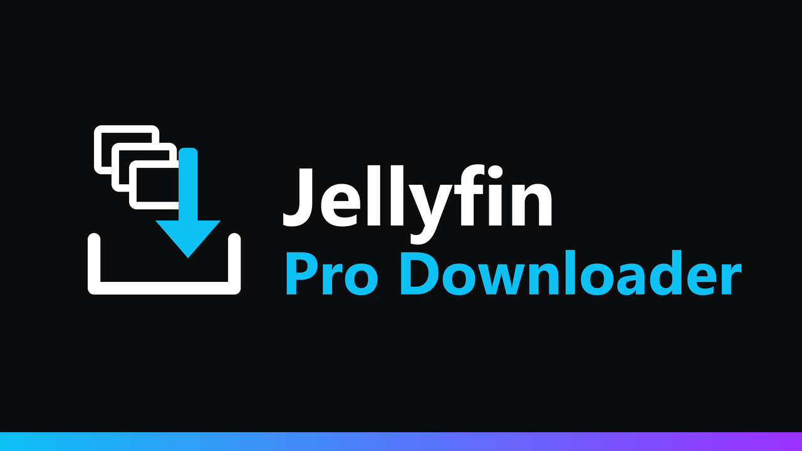

<p align="center">
  
</p>

<p align="center">
  <a href="https://github.com/k1k4k/jellyfin-pro-downloader/releases/latest"></a>
  
  <a href="https://github.com/k1k4k/jellyfin-pro-downloader/releases"></a>
  <a href="LICENSE"></a>
</p>

<p align="center">
  <b>Download a whole series without 200 downloads starting at once.</b><br>
  Pick what you want, choose how, and follow it in a download manager.
</p>

<p align="center">
  <a href="#installation">Installation</a> ·
  <a href="#features">Features</a> ·
  <a href="#troubleshooting">Troubleshooting</a> ·
  <a href="README.fr.md">Version française</a>
</p>

Out of the box, "Download all" on a series starts one browser download per episode, all at the same time: 204 episodes of a long show means 204 simultaneous downloads, dumped flat into the Downloads folder, with no way to tell which ones failed.

## Features

### Pick what to download

- **"Download…"** in the ⋮ menu of a series, season, album, artist, collection, playlist or folder opens a window instead of starting everything.
- Seasons, episodes, albums and tracks to check or uncheck, with their size and the total.
- **Extra files** next to the media are included when they exist: external subtitles, `.nfo`, images, lyrics (`.lrc`). One checkbox to leave them out.
- A **single movie or episode** downloads directly, without the window.

### Choose how

| Mode | Browsers | Result |
|---|---|---|
| **Into a folder** | Chrome, Edge, Opera on a computer, over HTTPS (or localhost) | Files organized in a folder you choose: `Show (2001)/Season 01/…`, `Artist/Album/…`. Files already there are skipped, so a big download can be finished another day. |
| **Queue** | any | The browser downloads the files one after another into your Downloads folder. The server tells the page when each file is done to start the next one. |
| **ZIP** | any | One archive per season / album, or a single one, with the folders already organized. Built on the fly (no compression, no temporary file, almost no CPU), its exact size is known up front and an interrupted download can be resumed. |

The window offers the best mode your browser supports and remembers your choice.

### Follow it

- A **download manager** (download icon at the top right) shows each download with its progress and speed: pause, resume, retry, cancel, and the history of finished ones (kept in your browser only).
- **Unfinished downloads are offered again** each time you open Jellyfin, after a confirmation.

### Server limits

Set in **Dashboard → Plugins → Jellyfin Pro Downloader**, applied by the server whatever the client does:

- simultaneous downloads per user (2 by default) and in total;
- maximum speed per user (unlimited by default), handy with a modest upload so others can keep streaming;
- which modes are offered;
- link expiry.

Each user's **"Allow media downloading"** permission (Dashboard → Users) is respected, and checked again on every file.

## Installation

### Plugin (recommended)

1. **Dashboard → Plugins → Manage Repositories → `+`**, then the k1k4k plugin repository URL matching your Jellyfin:

   | Jellyfin | Repository URL |
   |---|---|
   | 12.x | `https://k1k4k.github.io/jellyfin-plugins/manifest.json` |
   | 10.11.x | `https://k1k4k.github.io/jellyfin-plugins/manifest-10.11.json` |

   This repository lists every k1k4k plugin (Background Play, Player Queue, True Music Library…). If you already added it, or the Player Queue repository, there's nothing to do.

2. **Plugins → Available → Jellyfin Pro Downloader → Install**, then restart Jellyfin.
3. Reload the web page (`Ctrl+F5`).

New versions show up in the dashboard.

<details>
<summary><b>Other methods (without the repository)</b></summary>

#### Plugin, by hand

Download the zip from the [latest release](https://github.com/k1k4k/jellyfin-pro-downloader/releases/latest) (`_jf12` for Jellyfin 12, `_jf10` for 10.11), unzip it into `<config>/plugins/Jellyfin Pro Downloader/` and restart Jellyfin.

#### Install script

Copies the plugin into Jellyfin's `plugins` folder (latest release, a release zip, or built from these sources) and picks the right build for your server version.

```powershell
# Windows
.\install.ps1                                                                  # local Jellyfin
.\install.ps1 -PluginsDir "\\SERVER\plugins" -ServerUrl "http://SERVER:8096"   # network share
.\install.ps1 -Build                                                           # from the sources (.NET SDK 10, or 9 for 10.11)
.\install.ps1 -Uninstall
```

```bash
# Linux (plugins in /var/lib/jellyfin/plugins)
sudo ./install.sh --restart
sudo ./install.sh --uninstall
```

Then restart Jellyfin.

</details>

## Compatibility

| | |
|---|---|
| **Jellyfin 12.x** | tested (12.1.0) |
| **Jellyfin 10.11** | server tested (10.11.11); the web client code it hooks into is the same as in 12.x |
| **Web interface** (classic and new layout) | yes |
| **Apps that show the web UI** (Jellyfin Media Player, Android app) | should work, untested; apps with their own download feature keep it |
| **Native apps** (Swiftfin, Findroid…) | not affected |
| **Behind a reverse proxy, NAS, Docker** | yes; see the nginx note below |

## Troubleshooting

- **Nothing changes in the ⋮ menu**: reload the web page with `Ctrl+F5`, then check the browser console (F12): `[ProDownloader] v… – ready`.
- **Queue mode: only the first file downloads** (Chrome, Edge): the browser asks once whether the site may download multiple files. Allow it (icon at the right of the address bar), then **Retry** in the download manager.
- **Firefox asks where to save each file**: Firefox settings → General → Files and Applications → uncheck "Always ask you where to save files". Or use the ZIP mode.
- **"Into a folder" is greyed out**: it needs Chrome, Edge or Opera on a computer and Jellyfin served over **HTTPS** (or `localhost`). Firefox and Safari don't offer this feature to websites: use the queue or the ZIP.
- **A ZIP stops at the end of a long download, or a big file is cut**: behind nginx, let large responses through without buffering them to disk:

  ```nginx
  location / {
      proxy_pass http://jellyfin:8096;
      proxy_buffering off;
      proxy_read_timeout 1h;
  }
  ```

- **"Too many simultaneous downloads"**: the per-user limit is reached; the manager retries by itself. Raise it in the plugin settings if needed.
- **Download links stopped working**: links expire after 72 hours without activity (setting). Start the download again from the ⋮ menu; files already downloaded into a folder are skipped.
- **Unpacking a ZIP**: 7-Zip, Windows Explorer, macOS Archive Utility and `unzip` all handle archives over 4 GB.

<details>
<summary><b>Development</b></summary>

#### Plugin

`Jellyfin.Plugin.ProDownloader/`: one source, two targets, `-p:JellyfinTarget=jf12` (Jellyfin 12, .NET 10, default) and `jf10` (Jellyfin 10.11, .NET 9). The client script `jellyfin-pro-downloader.js` is embedded in the DLL and injected into `index.html` at request time (nothing is written to the web folder). Without a local SDK:

```bash
docker run --rm -v "$PWD:/src" -w /src mcr.microsoft.com/dotnet/sdk:10.0 dotnet build Jellyfin.Plugin.ProDownloader/Jellyfin.Plugin.ProDownloader.csproj -c Release -o out/jf12
```

#### API

| | |
|---|---|
| `POST /ProDownloader/Resolve` | tree of files for the picker (`{ "ItemIds": [...] }`) |
| `POST /ProDownloader/Jobs` | creates a download job from chosen files, optionally split into ZIP files |
| `GET /ProDownloader/Jobs/{id}` | job state (bytes sent, finished files) |
| `GET /ProDownloader/Jobs/{id}/Files/{n}/{name}` | one file, with `Range` |
| `GET /ProDownloader/Jobs/{id}/Zip/{n}/{name}` | one ZIP, with `Range` |

#### Releasing

1. Bump `<Version>` / `<AssemblyVersion>` in the csproj; add a `## X.Y.Z` section to `CHANGELOG.md`.
2. `git tag vX.Y.Z && git push origin vX.Y.Z`: the **Release** workflow builds both targets, publishes the release and updates the manifests on `main`. The central [`jellyfin-plugins`](https://github.com/k1k4k/jellyfin-plugins) repository picks them up on its next run (hourly, or right away with the `PLUGINS_REPO_TOKEN` secret).

</details>

## License

MIT, see [LICENSE](LICENSE).
